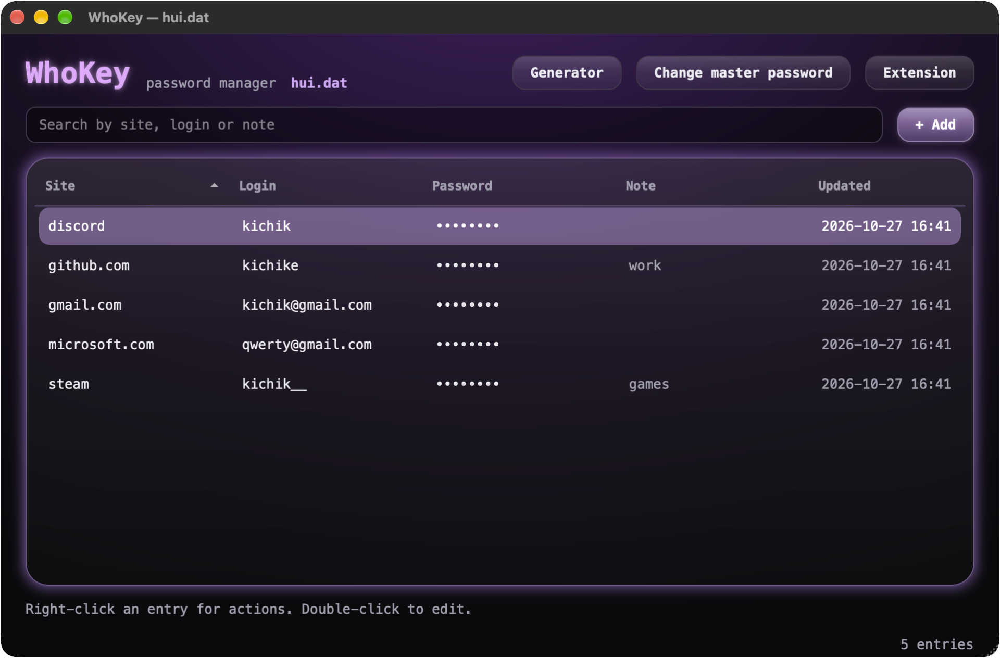
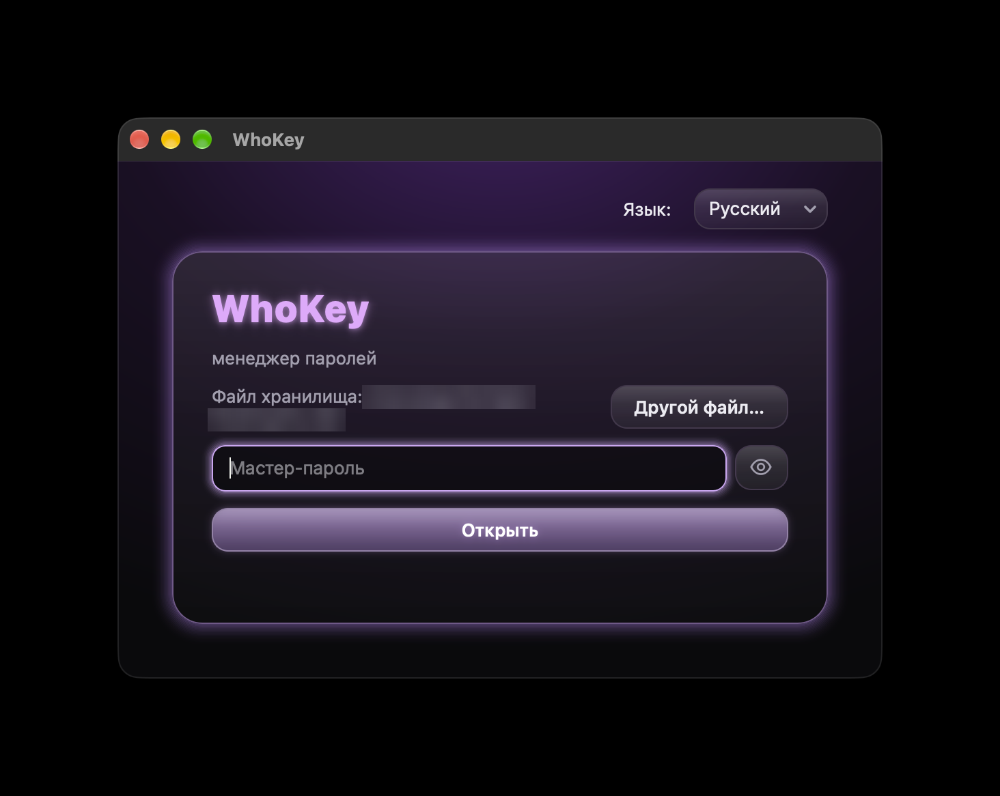
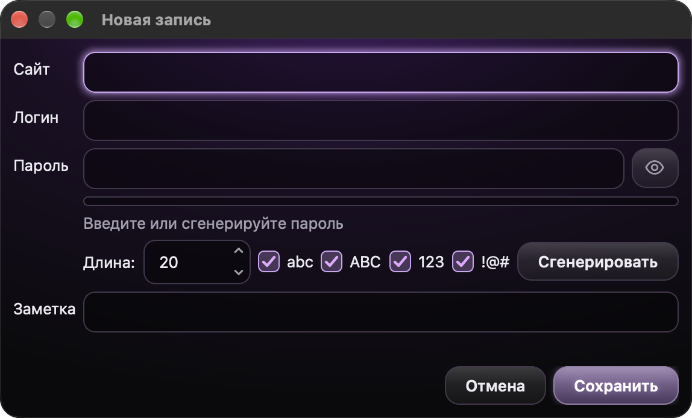

<p align="center">
  
</p>

<h1 align="center">WhoKey</h1>

<p align="center">A small password manager for macOS and Windows · Простой менеджер паролей для macOS и Windows</p>

<p align="center"><a href="#english">English</a> · <a href="#русский">Русский</a></p>

<p align="center">
  
</p>
<p align="center">
  
  
</p>

---

## English

WhoKey keeps your logins in one encrypted file that only opens with your master password.

### Features

- **Encryption:** the key is derived from the master password with Argon2id, and entries are encrypted with Fernet (the `cryptography` library). Nothing is stored in plain text.
- **Clipboard:** copied passwords are wiped after 30 seconds and when the app quits — a draining neon bar shows how much time is left. Clipboard history (Win+V, Raycast, Maccy…) and cloud clipboard are told to skip them.
- **Hidden by default:** a password you reveal hides itself again after 15 seconds.
- **Password generator** with length, letters, digits and symbols, plus a rough strength meter.
- **Search,** and right-click actions on any entry: show, copy password, copy login, edit, delete.
- **Backup copy:** a hidden backup sits next to the vault, so you only see one file. If the vault gets damaged, WhoKey offers to restore it.
- **Browser extension** (macOS, Chromium browsers): fills your login and password on websites — see below.
- **Auto-lock** when the screen is locked or the Mac goes to sleep.
- **English and Russian** interface.

By default the vault lives in `~/Library/Application Support/EduPasswords/vault.dat` on macOS (not synced to iCloud) and in `%APPDATA%\EduPasswords\vault.dat` on Windows. You can choose another file in the login window.

> ⚠️ The master password **cannot be recovered**. If you forget it, the vault is gone.
> WhoKey is a hobby app that has not had a professional security audit. For important accounts, an established manager such as Bitwarden or KeePassXC is a safer choice.

### Install

Download the installer from [Releases](../../releases).

**macOS (Apple Silicon):**
1. Open **WhoKey Installer.dmg** and drag WhoKey into **Applications**.
2. The app is not notarized by Apple, so macOS blocks the first launch. Go to **System Settings → Privacy & Security** and click **Open Anyway**.

**Windows 10/11 (64-bit):**
1. Run **WhoKey Installer.exe**. No administrator rights needed.
2. The installer is not code-signed, so Windows SmartScreen may warn you. Click **More info → Run anyway**.
3. WhoKey appears in the Start menu. Uninstall it from **Settings → Apps**; your vault is kept.

### Browser extension (macOS)

Fills the login and password on a website with one click or **⌘⇧L**. Works in Chrome, Edge, Brave, Arc, Vivaldi, Yandex Browser and Helium. Windows support is coming in 1.4.

1. Install WhoKey and open it once — it registers itself in your browsers.
2. Download **WhoKey-extension.zip** from [Releases](../../releases) and unzip it (or use the `extension` folder of this repository).
3. Open `chrome://extensions`, turn on **Developer mode**, click **Load unpacked** and choose the unzipped folder.
4. In WhoKey, set **Website** (`github.com`) in the entries you want to fill.
5. On a login page, click the WhoKey icon. The first time, WhoKey asks for permission — allow it only if the code matches the one in the extension popup.

How it protects your passwords:
- A password is given only to its own website and its subdomains: an entry for `mail.ru` fills on `e.mail.ru`, but never on `mail.ru.evil.com` or `mai1.ru`. Only on https pages.
- It fills only when you click (never by itself), only in fields you can actually see, and only after WhoKey is unlocked. If WhoKey is closed, the extension opens it and waits for your master password.
- The extension talks to WhoKey without the network, through a local socket only your user can open. WhoKey answers only its own bridge program, and the bridge talks only to WhoKey.
- You can disconnect the extension any time: **Extension** button in WhoKey.

Honest limits:
- No password manager can fully protect you from malware already running under your user account; WhoKey makes it harder, not impossible.
- Don't use filling on a page where you clicked through a certificate warning — the address bar shows the real site, but the page may not be.
- Install the extension only from this repository.

### Run from source

Requires Python 3.9 or newer.

```sh
python3 -m venv .venv
.venv/bin/pip install -r requirements.txt
.venv/bin/python app.py
```

On Windows, use `.venv\Scripts\python app.py`.

To build the installers yourself: on macOS run `./build_dmg.sh`; on Windows run `python build_windows.py`, then compile `installer.iss` with [Inno Setup](https://jrsoftware.org/isinfo.php). Both appear in `dist/`. GitHub Actions builds and tests the Windows version automatically. Tests: `python -m unittest discover tests`.

### Contact

Questions and ideas — write me on Telegram: [@kichik_e](https://t.me/kichik_e)

---

## Русский

WhoKey хранит логины и пароли в одном зашифрованном файле. Открыть его можно только мастер-паролем.

### Возможности

- **Шифрование:** ключ получается из мастер-пароля через Argon2id, записи шифруются Fernet (библиотека `cryptography`). Ничего не хранится открытым текстом.
- **Буфер обмена:** скопированный пароль стирается через 30 секунд и при выходе из программы, неоновая полоска показывает, сколько осталось. Журналу буфера (Win+V, Raycast, Maccy…) и облачному буферу запрещено его запоминать.
- **Пароли скрыты:** показанный пароль сам прячется через 15 секунд.
- **Генератор паролей:** длина, буквы, цифры, символы и примерная шкала надёжности.
- **Поиск** и действия с записью по правому клику: показать, скопировать пароль или логин, изменить, удалить.
- **Резервная копия:** скрытая копия лежит рядом с хранилищем, так что в папке виден один файл. Если хранилище испортится, WhoKey предложит восстановить его.
- **Расширение для браузера** (macOS, браузеры на Chromium): заполняет логин и пароль на сайтах — подробнее ниже.
- **Автоблокировка** при блокировке экрана и сне Mac.
- Интерфейс на **русском и английском**.

По умолчанию хранилище лежит в `~/Library/Application Support/EduPasswords/vault.dat` на macOS (эта папка не синхронизируется с iCloud) и в `%APPDATA%\EduPasswords\vault.dat` на Windows. Другой файл можно выбрать в окне входа.

> ⚠️ Мастер-пароль **нельзя восстановить**. Забыли его — хранилище не открыть.
> WhoKey — любительская программа, профессиональной проверки безопасности она не проходила. Для важных аккаунтов надёжнее проверенные менеджеры, например Bitwarden или KeePassXC.

### Установка

Скачайте установщик в разделе [Releases](../../releases).

**macOS (Apple Silicon):**
1. Откройте **WhoKey Installer.dmg** и перетащите WhoKey в «Программы».
2. Приложение не заверено Apple, поэтому macOS заблокирует первый запуск. Откройте «Системные настройки → Конфиденциальность и безопасность» и нажмите «Всё равно открыть».

**Windows 10/11 (64-бит):**
1. Запустите **WhoKey Installer.exe**. Права администратора не нужны.
2. Установщик не подписан, поэтому Windows SmartScreen может предупредить. Нажмите «Подробнее → Выполнить в любом случае».
3. WhoKey появится в меню «Пуск». Удалить его можно в «Параметры → Приложения»; хранилище при этом сохранится.

### Расширение для браузера (macOS)

Заполняет логин и пароль на сайте одним нажатием или **⌘⇧L**. Работает в Chrome, Edge, Brave, Arc, Vivaldi, Яндекс Браузере и Helium. Поддержка Windows — в версии 1.4.

1. Установите WhoKey и откройте его хотя бы раз — он сам пропишется в браузерах.
2. Скачайте **WhoKey-extension.zip** в разделе [Releases](../../releases) и распакуйте (или возьмите папку `extension` из этого репозитория).
3. Откройте `chrome://extensions`, включите **Режим разработчика**, нажмите **Загрузить распакованное** и выберите распакованную папку.
4. В WhoKey укажите **Адрес сайта** (`github.com`) в записях, которые хотите заполнять.
5. На странице входа нажмите иконку WhoKey. В первый раз WhoKey спросит разрешение — разрешайте, только если код совпадает с кодом в окошке расширения.

Как защищены пароли:
- Пароль выдаётся только своему сайту и его поддоменам: запись `mail.ru` заполняется на `e.mail.ru`, но никогда — на `mail.ru.evil.com` или `mai1.ru`. Только на страницах с https.
- Заполняет только по нажатию (никогда само), только в поля, которые реально видно, и только когда WhoKey разблокирован. Если WhoKey закрыт, расширение откроет его и подождёт мастер-пароль.
- Расширение общается с WhoKey без сети, через локальный сокет, доступный только вашему пользователю. WhoKey отвечает только своему мосту, а мост говорит только с WhoKey.
- Отключить расширение можно в любой момент: кнопка **Расширение** в WhoKey.

Честные ограничения:
- Ни один менеджер паролей не защищает полностью от вредоносной программы, уже запущенной под вашим пользователем; WhoKey усложняет ей жизнь, но не делает это невозможным.
- Не пользуйтесь заполнением на странице, где вы нажали «всё равно перейти» при ошибке сертификата: в адресной строке настоящий сайт, а страница может быть подменена.
- Ставьте расширение только из этого репозитория.

### Запуск из исходников

Нужен Python 3.9 или новее.

```sh
python3 -m venv .venv
.venv/bin/pip install -r requirements.txt
.venv/bin/python app.py
```

На Windows: `.venv\Scripts\python app.py`.

Чтобы самому собрать установщики: на macOS запустите `./build_dmg.sh`; на Windows — `python build_windows.py`, а потом соберите `installer.iss` в [Inno Setup](https://jrsoftware.org/isinfo.php). Оба появятся в папке `dist/`. Windows-версию GitHub Actions собирает и проверяет автоматически. Тесты: `python -m unittest discover tests`.

### Связь

Вопросы и идеи — пишите в Telegram: [@kichik_e](https://t.me/kichik_e)

---

The MesloLGS Nerd Font is used under the Apache License 2.0 (`gui/fonts/LICENSE.txt`).
Шрифт MesloLGS Nerd Font распространяется по лицензии Apache 2.0 (`gui/fonts/LICENSE.txt`).
