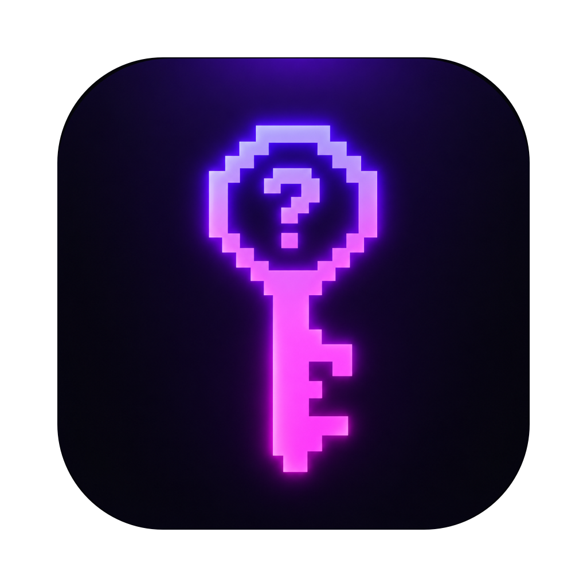

<p align="center">
  
</p>

<h1 align="center">WhoKey</h1>

<p align="center">A small password manager for macOS and Windows · Простой менеджер паролей для macOS и Windows</p>

<p align="center"><a href="#english">English</a> · <a href="#русский">Русский</a></p>

---

## English

WhoKey keeps your logins in one encrypted file that only opens with your master password.

### Features

- **Encryption:** the key is derived from the master password with Argon2id, and entries are encrypted with Fernet (the `cryptography` library). Nothing is stored in plain text.
- **Clipboard:** copied passwords are wiped after 30 seconds and when the app quits — a draining neon bar shows how much time is left. Clipboard history (Win+V, Raycast, Maccy…) and cloud clipboard are told to skip them.
- **Hidden by default:** a password you reveal hides itself again after 15 seconds.
- **Password generator** with length, letters, digits and symbols, plus a rough strength meter.
- **Search,** and right-click actions on any entry: show, copy password, copy login, edit, delete.
- **Backup copy:** a hidden backup sits next to the vault, so you only see one file. If the vault gets damaged, WhoKey offers to restore it.
- **English and Russian** interface.

By default the vault lives in `~/Library/Application Support/EduPasswords/vault.dat` on macOS (not synced to iCloud) and in `%APPDATA%\EduPasswords\vault.dat` on Windows. You can choose another file in the login window.

> ⚠️ The master password **cannot be recovered**. If you forget it, the vault is gone.
> WhoKey is a hobby app that has not had a professional security audit. For important accounts, an established manager such as Bitwarden or KeePassXC is a safer choice.

### Install

Download the installer from [Releases](../../releases).

**macOS (Apple Silicon):**
1. Open **WhoKey Installer.dmg** and drag WhoKey into **Applications**.
2. The app is not notarized by Apple, so macOS blocks the first launch. Go to **System Settings → Privacy & Security** and click **Open Anyway**.

**Windows 10/11 (64-bit):**
1. Run **WhoKey Installer.exe**. No administrator rights needed.
2. The installer is not code-signed, so Windows SmartScreen may warn you. Click **More info → Run anyway**.
3. WhoKey appears in the Start menu. Uninstall it from **Settings → Apps**; your vault is kept.

### Run from source

Requires Python 3.9 or newer.

```sh
python3 -m venv .venv
.venv/bin/pip install -r requirements.txt
.venv/bin/python app.py
```

On Windows, use `.venv\Scripts\python app.py`.

To build the installers yourself: on macOS run `./build_dmg.sh`; on Windows run `python build_windows.py`, then compile `installer.iss` with [Inno Setup](https://jrsoftware.org/isinfo.php). Both appear in `dist/`. GitHub Actions builds and tests the Windows version automatically.

---

## Русский

WhoKey хранит логины и пароли в одном зашифрованном файле. Открыть его можно только мастер-паролем.

### Возможности

- **Шифрование:** ключ получается из мастер-пароля через Argon2id, записи шифруются Fernet (библиотека `cryptography`). Ничего не хранится открытым текстом.
- **Буфер обмена:** скопированный пароль стирается через 30 секунд и при выходе из программы, неоновая полоска показывает, сколько осталось. Журналу буфера (Win+V, Raycast, Maccy…) и облачному буферу запрещено его запоминать.
- **Пароли скрыты:** показанный пароль сам прячется через 15 секунд.
- **Генератор паролей:** длина, буквы, цифры, символы и примерная шкала надёжности.
- **Поиск** и действия с записью по правому клику: показать, скопировать пароль или логин, изменить, удалить.
- **Резервная копия:** скрытая копия лежит рядом с хранилищем, так что в папке виден один файл. Если хранилище испортится, WhoKey предложит восстановить его.
- Интерфейс на **русском и английском**.

По умолчанию хранилище лежит в `~/Library/Application Support/EduPasswords/vault.dat` на macOS (эта папка не синхронизируется с iCloud) и в `%APPDATA%\EduPasswords\vault.dat` на Windows. Другой файл можно выбрать в окне входа.

> ⚠️ Мастер-пароль **нельзя восстановить**. Забыли его — хранилище не открыть.
> WhoKey — любительская программа, профессиональной проверки безопасности она не проходила. Для важных аккаунтов надёжнее проверенные менеджеры, например Bitwarden или KeePassXC.

### Установка

Скачайте установщик в разделе [Releases](../../releases).

**macOS (Apple Silicon):**
1. Откройте **WhoKey Installer.dmg** и перетащите WhoKey в «Программы».
2. Приложение не заверено Apple, поэтому macOS заблокирует первый запуск. Откройте «Системные настройки → Конфиденциальность и безопасность» и нажмите «Всё равно открыть».

**Windows 10/11 (64-бит):**
1. Запустите **WhoKey Installer.exe**. Права администратора не нужны.
2. Установщик не подписан, поэтому Windows SmartScreen может предупредить. Нажмите «Подробнее → Выполнить в любом случае».
3. WhoKey появится в меню «Пуск». Удалить его можно в «Параметры → Приложения»; хранилище при этом сохранится.

### Запуск из исходников

Нужен Python 3.9 или новее.

```sh
python3 -m venv .venv
.venv/bin/pip install -r requirements.txt
.venv/bin/python app.py
```

На Windows: `.venv\Scripts\python app.py`.

Чтобы самому собрать установщики: на macOS запустите `./build_dmg.sh`; на Windows — `python build_windows.py`, а потом соберите `installer.iss` в [Inno Setup](https://jrsoftware.org/isinfo.php). Оба появятся в папке `dist/`. Windows-версию GitHub Actions собирает и проверяет автоматически.

---

The Inter font is used under the SIL Open Font License (`gui/fonts/LICENSE.txt`).
Шрифт Inter распространяется по лицензии SIL Open Font License (`gui/fonts/LICENSE.txt`).
